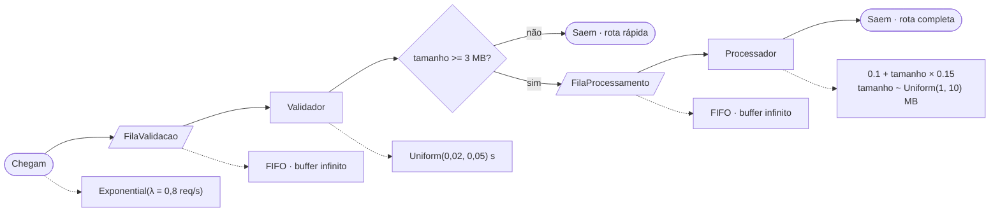

# Modelo conceitual — API de processamento de imagens

Documentação do modelo conceitual do sistema simulado em `api_simulator.py`,
produzida **antes** de qualquer alteração de código, como acordo formal sobre
o que está sendo modelado (etapa "Modelagem conceitual" do TGA).

## Fluxograma

*Legenda do fluxo:* chegadas em **Exponential(λ = 0,8 req/s)**; toda
requisição passa pela **FilaValidacao** (FIFO, buffer infinito) e pelo
**Validador**; a partir daí, uma **decisão de rota condicional** com base no
tamanho da imagem decide se ela sai direto (rota rápida, imagem já pequena o
suficiente) ou segue para **FilaProcessamento → Processador** (rota completa,
tempo de serviço linear no tamanho da imagem).

## Entidades, recursos e regras

- **Entidades**: requisições de processamento de imagem — uma por usuário,
  `1000` no total (cada usuário envia exatamente uma
  requisição).
- **Recursos**:
  - `Validador` — servidor único, capacidade 1, verifica a requisição e mede
    o tamanho da imagem.
  - `Processador` — servidor único, capacidade 1 (sem paralelismo), aplica o
    processamento pesado (redimensionamento/filtros).
- **Filas**: `FilaValidacao` e `FilaProcessamento` — ambas FIFO, buffer
  infinito (nenhuma requisição é descartada por falta de espaço).
- **Regras de rota**: decisão **condicional**, tomada logo após o
  `Validador`, com base no tamanho da imagem (`tamanho_imagem`, amostrado na
  chegada): requisições com `tamanho_imagem < LIMIAR_ROTA_MB` (3 MB) são
  consideradas já otimizadas e saem direto (**rota rápida**), sem passar pelo
  `Processador`; as demais seguem para `FilaProcessamento → Processador`
  (**rota completa**), como no fluxo original.

## Distribuições de entrada

| Grandeza | Distribuição | Parâmetros | Unidade | Constante no código |
|---|---|---|---|---|
| Intervalo entre chegadas | Exponential | λ = 0,8 | req/s | `TAXA_CHEGADA` |
| Tamanho da imagem | Uniform | mín 1, máx 10 | MB | `TAMANHO_MIN`, `TAMANHO_MAX` |
| Tempo de validação | Uniform | mín 0,02, máx 0,05 | s | `TEMPO_VALIDACAO_MIN`, `TEMPO_VALIDACAO_MAX` |
| Tempo de processamento (rota completa) | Determinístico (função linear do tamanho) | base 0,1 + 0,15 × tamanho | s | `TEMPO_BASE`, `TEMPO_POR_UNIDADE` |

> Fonte dos dados: parâmetros de exemplo, ainda não substituídos por
> observação real (~25 tempos por atividade). Mantidos como placeholder por
> decisão explícita nesta etapa — ver `CLAUDE.md` do projeto.

## Métricas Analisadas
- Tempo médio e máximo de resposta ao request (fim a fim);
- Tempo médio de espera e tamanho médio de fila, por recurso (`Validador` e
  `Processador`);
- Utilização de cada recurso (`Validador` e `Processador`);
- Contagem e percentual de requisições por rota (rápida vs. completa).

## Classificação do sistema

- Sistema Dinâmico: Quantidade de requests podem variar com o tempo;
- Sistema Estocástico: Depende dos intervalos de chegada dos requests,
que não são fixos no tempo;
- Sistema Discreto: Avança de acordo com a conclusão de cada request.

## Questões do estudo (rascunho)

Três perguntas candidatas, no padrão *cenário + indicador + critério*. O
limiar `X` é um placeholder — a validar com o usuário antes da próxima etapa
(coleta de dados / experimentação):

1. Com a taxa de chegada atual (0,8 req/s) e um único processador, o tempo
   médio de espera na fila fica abaixo de **X segundos**?
2. Com um único processador, a utilização do servidor ultrapassa **90%**
   sob a taxa de chegada atual — sinal de fila crescente e risco de
   degradação do serviço?
3. Com a decisão de rota atual (limiar de 3 MB), a rota rápida (sem
   `Processador`) responde a pelo menos **20%** das requisições — reduzindo
   de fato a carga sobre o `Processador` em relação a um fluxo sem
   ramificação?

## Próximos passos

- Refinar as três questões acima, definindo os limiares `X` e `Y` junto com
  o usuário.
- Planejar coleta real de dados de entrada (ou justificar formalmente os
  valores atuais como estimativa) antes da etapa de experimentação.
- Planejar infraestrutura de replicações (mínimo 10) e cálculo de intervalo
  de confiança do indicador principal.
