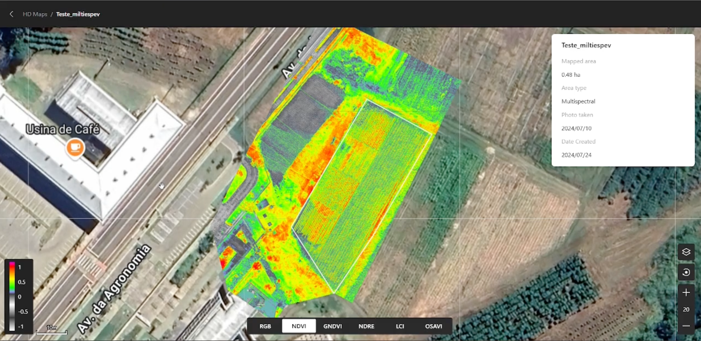
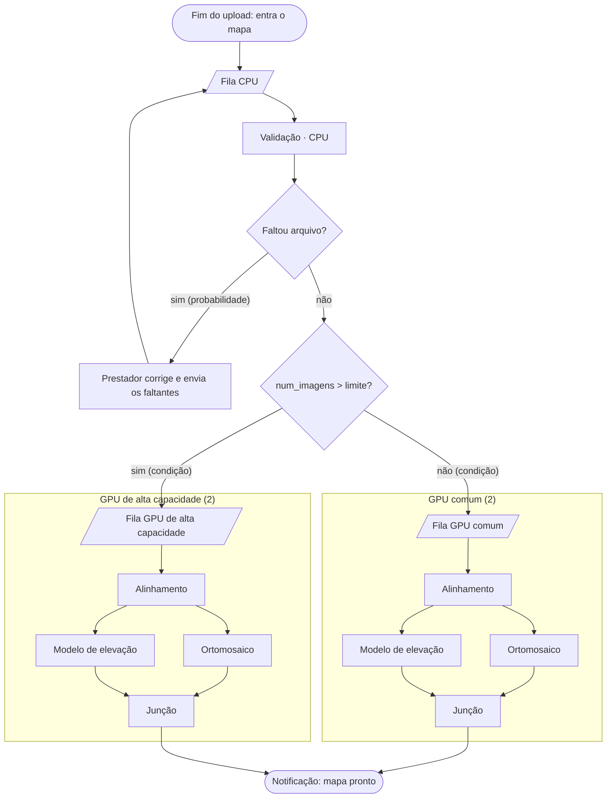

# Modelo conceitual: Processamento de Imagens de Drones

Documento-base do Trabalho do Grau B, feito antes da implementação. Registra o sistema estudado, o modelo definido pelo grupo e o motivo de cada decisão.

**Situação:** a estrutura do modelo está definida. Os valores das distribuições são iniciais e ainda serão verificados (ver [Pontos a verificar](#pontos-a-verificar)).

## Parte 1: o sistema

### O que estamos modelando

Uma plataforma que recebe imagens capturadas por drones e as transforma em mapas topográficos de alta resolução. Em vez de instalar software e manter computadores potentes, o prestador de serviço envia as fotos de um voo e recebe o mapa pronto.

*Exemplo do tipo de plataforma estudada: um talhão de 0,48 ha mapeado com câmera multiespectral, exibido na camada NDVI. A tela também oferece RGB e outros índices (GNDVI, NDRE, LCI e OSAVI). A imagem é ilustrativa: o estudo modela apenas os produtos descritos abaixo.*

### Um dia do prestador de serviço

Pela manhã, a equipe do prestador sai para atender uma fazenda. O cliente quer um mapa atualizado de um **talhão**, uma área delimitada da lavoura, para acompanhar o terreno e a plantação.

Em campo, o operador define a área do voo e o drone percorre o talhão em faixas paralelas. Ele fotografa o terreno em intervalos regulares, de modo que cada foto se sobreponha às vizinhas. É essa sobreposição que depois permite montar uma imagem única e reconstruir o relevo. Ao final, os arquivos ficam no cartão do drone, e a equipe segue para o próximo voo ou para outra fazenda.

No fim do dia, a equipe volta à empresa e envia à plataforma os arquivos de cada voo. Cada voo enviado dá origem a um **mapa**, que é o que a plataforma processa. O prestador não precisa acompanhar o processamento: ele fecha a plataforma e é notificado quando o mapa fica pronto.

Às vezes falta algo, como fotos que ficaram para trás ao copiar o cartão. Nesse caso, a plataforma avisa o prestador, que envia o que faltou, e o mapa volta a ser conferido.

### O que a plataforma processa

1. **Validação:** confere se o prestador enviou todos os arquivos necessários. Essa etapa roda em CPU, antes de ocupar uma GPU.
2. **Alinhamento:** identifica pontos em comum entre as fotos sobrepostas e calcula a posição de cada uma. O resultado serve de base para os dois produtos seguintes.
3. **Geração dos produtos,** feita em paralelo a partir do alinhamento:
   - **Ortomosaico:** as fotos costuradas e corrigidas, formando uma imagem única e sem distorção.
   - **Modelo de elevação:** a altura de cada ponto do terreno, que dá o caráter topográfico ao mapa.
4. **Entrega:** quando os dois produtos terminam, o mapa fica pronto e o prestador é notificado.

### O problema de gestão

Como as equipes voltam do campo em horários parecidos, os envios se concentram no fim do dia e disputam as mesmas GPUs. Formam-se filas justamente no período de maior demanda, e o prestador tem um prazo a cumprir com o cliente.

A plataforma promete o mapa em até **5 minutos**. A gestão precisa saber se a capacidade atual cumpre essa meta no pico ou se vale a pena acrescentar uma GPU.

## Parte 2: modelo conceitual

### Fluxograma

*Legenda:* o mapa entra quando termina o primeiro upload e passa pela validação em CPU. Se faltar arquivo, volta à fila da CPU após a correção pelo prestador. Se estiver completo, segue a rota definida pelo número de imagens e usa somente as GPUs desse grupo até o fim. Cada grupo tem uma única fila, usada por todas as etapas de GPU: depois do alinhamento, ortomosaico e modelo de elevação voltam a essa fila e disputam as GPUs com os mapas que ainda vão alinhar. A junção espera os dois produtos, e o mapa segue para a notificação.

### Entidades e atributos

**Entidade:** mapa, que representa o processamento de um voo, do fim do primeiro upload até a notificação.

| Atributo | Significado | Uso no modelo |
|---|---|---|
| `num_imagens` | Quantidade de imagens do voo | Define a rota e os tempos de GPU |
| `rota` | Comum ou alta capacidade | Define o grupo de GPUs |
| `tentativas` | Número de passagens pela validação | Identifica mapas que precisaram de correção |
| `instante_entrada` | Fim do primeiro upload | Início do lead time; não muda em caso de reenvio |
| `instante_saida` | Notificação de mapa pronto | Fim do lead time |

### Recursos

| Recurso | Capacidade (cenário atual) | Etapas |
|---|---|---|
| `CPU` | 1 | Validação |
| `GPU comum` | 2 | Alinhamento e produtos dos mapas até o limite de imagens |
| `GPU de alta capacidade` | 2 | Alinhamento e produtos dos mapas acima do limite |

Cada etapa ocupa uma unidade do recurso e a libera ao terminar. Os dois produtos disputam as GPUs de forma independente, então só rodam ao mesmo tempo se houver duas livres.

O prestador não é um recurso: a correção é um atraso sem fila, porque cada um corrige o próprio envio.

### Filas

`Fila CPU`, `Fila GPU comum` e `Fila GPU de alta capacidade`, todas FIFO e sem limite de buffer. Nenhum mapa é descartado ou desiste.

Cada grupo de GPUs tem uma única fila, compartilhada por alinhamento, ortomosaico e modelo de elevação. Um mapa entra nela três vezes, uma por tarefa, e a GPU que fica livre pega a tarefa mais antiga, sem distinguir o tipo.

### Regras de fluxo

- **Decisão por probabilidade:** na validação, cada tentativa tem a mesma chance de detectar arquivos faltando. O mapa repete a validação até passar.
- **Reenvio:** o prestador envia só os arquivos faltantes, o que não altera `num_imagens`. O relógio do lead time continua correndo.
- **Decisão por condição:** mapas com `num_imagens` acima do limite vão para a GPU de alta capacidade; os demais, para a GPU comum.
- **Fluxo paralelo:** após o alinhamento, o mapa se duplica em ortomosaico e modelo de elevação. A junção espera os dois, e o mapa sai quando o último termina.

### Chegadas e horizonte

Os envios se concentram no fim do dia, com pico entre 17h e 21h. Cada replicação simula uma noite de pico, com relógio em minutos, e termina quando o último mapa fica pronto. Por isso, é uma simulação terminante.

### Distribuições de entrada

**Todos os valores são iniciais e estão a verificar.** Ainda não têm fonte, e a coluna de justificativa será preenchida na verificação, como exige o enunciado.

| Grandeza | Distribuição | Parâmetros | Unidade | Justificativa |
|---|---|---|---|---|
| Mapas por noite | Poisson | média 250 | mapas/noite | A preencher |
| Horário de envio | Triangular | mín 17h, moda 18h30, máx 21h | hora | Retorno concentrado das equipes; valores a preencher |
| `num_imagens` | Triangular | mín 20, moda 80, máx 200 | imagens | Mapas pequenos (poucas imagens); valores a preencher |
| Limite da rota | Constante | 80 | imagens | A preencher |
| Tempo de validação | Uniform | mín 5, máx 15 | s | A preencher |
| Falta de arquivos | Bernoulli | 5% por tentativa | probabilidade | A preencher |
| Tempo de correção | Uniform | mín 1, máx 3 | min | A preencher |
| Alinhamento, GPU comum | Uniform | mín 0,3, máx 0,5 | s/imagem | A preencher |
| Ortomosaico, GPU comum | Uniform | mín 0,4, máx 0,6 | s/imagem | A preencher |
| Modelo de elevação, GPU comum | Uniform | mín 0,3, máx 0,5 | s/imagem | A preencher |
| GPU de alta capacidade | Fator sobre a GPU comum | 0,5 × o tempo | adimensional | A preencher |

Em cada etapa de GPU, o tempo é `num_imagens` × tempo por imagem sorteado × fator da GPU (1 na comum).

### Indicadores

1. **P90 do lead time (indicador principal),** em minutos, medido do fim do primeiro upload até a notificação de mapa pronto, incluída a correção pelo prestador, com meta de até 5 min. É calculado por noite simulada, e o IC de 95% é obtido entre as replicações.
2. **Mapas fora do prazo,** em mapas por noite, medidos do fim do primeiro upload até a notificação de mapa pronto, contando aqueles com lead time acima de 5 min, com meta de até 10% dos mapas da noite. *O percentual é uma proposta a confirmar.*

**Complementares:** lead time médio (min), vazão (mapas/h) e utilização de cada grupo de GPUs (%).

### Cenários

| Cenário | GPUs comuns | GPUs de alta capacidade | Demanda | Replicações |
|---|---|---|---|---|
| Atual | 2 | 2 | Pico | ≥ 30 |
| GPU extra | 2 | 3 | Pico | ≥ 30 |

A comparação usa o IC de 95% do P90 do lead time. Intervalos que não se sobrepõem indicam diferença conclusiva; intervalos sobrepostos não permitem concluir pela diferença.

### Questões do estudo

1. Na situação atual, o P90 do lead time atende à meta de 5 min no pico?
2. Uma GPU de alta capacidade a mais reduz o P90 do lead time com IC sem sobreposição? Em quantos minutos?
3. Quantos mapas por noite deixam de ficar fora do prazo com a GPU extra?

### Classificação do sistema

- **Dinâmico:** o estado muda ao longo da noite, com filas que crescem no pico e depois se esvaziam.
- **Estocástico:** chegadas, quantidades de imagens por mapa, tempos de serviço e falta de arquivos são aleatórios.
- **Discreto:** o estado muda em instantes definidos, como chegadas e conclusões de etapas.

### Hipóteses e simplificações

- **Mapas pequenos (poucas imagens):** fotogrametria completa de voos grandes costuma levar bem mais de 5 min, portanto o estudo vale para voos pequenos. Essa afirmação ainda precisa de fonte.
- **Tempos proporcionais:** os tempos de GPU crescem na proporção do número de imagens.
- **Upload fora do modelo:** o relógio começa no fim do primeiro upload. O envio dos faltantes faz parte do tempo de correção.
- **Prestador sempre corrige:** não há desistência, e a correção não depende de quantos arquivos faltaram.
- **Sem falhas técnicas:** as GPUs não param, e o alinhamento e a geração dos produtos sempre dão certo.
- **Mapas de índices fora do escopo:** a plataforma do exemplo também exibe índices como o NDVI, mas o estudo modela apenas ortomosaico e modelo de elevação.
- **Apenas a noite de pico:** os resultados não se aplicam a períodos de demanda normal.

## Atendimento aos requisitos do enunciado (seção 3)

| Item | Requisito | Solução no modelo |
|---|---|---|
| a | Base do estudo | Este documento; justificativas das distribuições pendentes |
| b | Decisões | Probabilidade: falta de arquivos. Condição: rota por `num_imagens` |
| c | Indicadores | Mapas fora do prazo (contagem) e P90 do lead time |
| d | Atributo com significado | `num_imagens`, usado na rota e nos tempos |
| e | Lotes ou duplicações | Ortomosaico e modelo de elevação em paralelo, com junção |
| f | Demonstração visual | Monitor amostra filas, GPUs ocupadas e mapas concluídos. A cena traz título do cenário, relógio, ao menos três indicadores com unidade e um gráfico com eixos rotulados |
| g | Gráficos de resultados | Mapas na fila da GPU de alta capacidade ao longo da noite, em degraus; P90 do lead time por cenário, com IC em barras de erro |
| h | Experimentação | Dois cenários, 30 ou mais replicações e IC de 95% do P90 |
| i | Análise | A fazer após os resultados, sempre com número, unidade e comparação |

## Registro de decisões

| Decisão | Por quê | Alternativas descartadas |
|---|---|---|
| Python + SimPy | Ferramenta aceita pela disciplina e já usada no Grau A | JaamSim, Arena |
| Usuário: prestador de serviço | Envia vários voos e tem prazos a cumprir com clientes, o que dá sentido à meta | Produtor rural; os dois perfis |
| Upload ao fim do voo, chegando à plataforma no fim do dia | A equipe termina o campo, volta à empresa e sobe os arquivos, o que concentra a demanda | Envio imagem a imagem; upload no campo com falhas |
| Prestador sai e é notificado | Corresponde ao uso esperado e mantém o lead time como foco | Cancelar na fila; reenviar por demora |
| Falha na validação, por falta de arquivos | É um erro do prestador, detectado antes de ocupar GPU | Falha no alinhamento; falha maior em mapas grandes; limite de reenvios |
| Reenvio só dos faltantes, repetindo até dar certo | Todo mapa termina, e o lead time fica definido para todos | Reenviar o voo inteiro |
| Lead time desde o primeiro envio | Mostra a espera real e segue a definição do enunciado | Contar cada envio separadamente |
| Rota por `num_imagens` | É uma decisão condicional natural e dá uso direto ao atributo | Rejeição por qualidade; prioridade por prazo |
| Ortomosaico + modelo de elevação em paralelo | Tarefas paralelas a partir do alinhamento, sem exigir câmera multiespectral | Mapa de índices; blocos de imagens; voos em lote |
| 2 GPUs por grupo | Os dois produtos podem rodar ao mesmo tempo em cada rota | Grupo único; grupo separado para os produtos |
| Fila única FIFO por grupo de GPUs | É a regra mais simples de implementar e explicar. Em troca, mapas já alinhados podem esperar atrás de novos mapas | Prioridade para os produtos; GPUs separadas por etapa |
| Comparar atual e GPU extra no pico | Responde diretamente à decisão de investimento | Fatorial 2×2; normal × pico; prioridade × FIFO |
| Meta de 5 min | Definida pelo grupo; a escala de tempo curta é parte do estudo | Metas de 12 h ou 24 h |
| Mapas pequenos (poucas imagens) | Tornam a meta de 5 min coerente com o tempo de processamento | Modo rápido hipotético; revisar a meta após pesquisa |
| Chegadas Triangular(17h, 18h30, 21h) | Representam o retorno concentrado das equipes e fazem a fila crescer | Poisson em janela fixa; pulsos por empresa |
| Contagem: mapas fora do prazo | Reage à GPU extra e ajuda a comparar os cenários | Mapas reenviados; mapas concluídos |

## Pontos a verificar

- [ ] **Valores das distribuições:** verificar e justificar cada um.
- [ ] **Meta de mapas fora do prazo:** confirmar o limite de 10% e definir o valor absoluto.
- [ ] **Gargalo:** confirmar que está nas GPUs de alta capacidade. Pela conta manual no instante de maior demanda (cerca de 125 mapas/h), elas ficariam perto de 90% de ocupação, e as comuns perto de 45%. Se o gargalo estiver nas comuns, a GPU extra pode não alterar o P90.
- [ ] **Sensibilidade da comparação:** confirmar que o cenário atual fica perto da meta. Se o sistema folgar nos dois cenários, a comparação não mostrará diferença.
- [ ] **Peso dos reenvios:** os 5% de falha ficam perto dos 10% tolerados pelo P90. Confirmar que os mapas com correção não determinam o P90 sozinhos.
- [ ] **Hipótese de mapas pequenos:** buscar fonte para os tempos de fotogrametria.

## Próximos passos

1. Verificar os valores das distribuições.
2. Implementar o modelo em caderno Python com SimPy, usando como referência `../grau-a/api_simulator.py` e `../grau-a/executar_replicacoes.py`, sem depender desses arquivos.
3. Rodar os cenários e calcular os indicadores e os IC.
4. Gerar os gráficos e a animação em MP4 com `FuncAnimation`.
5. Escrever o relatório, com a declaração de uso de IA, e preparar os slides.
6. Obter no Moodle o template do relatório e confirmar a data de entrega.
