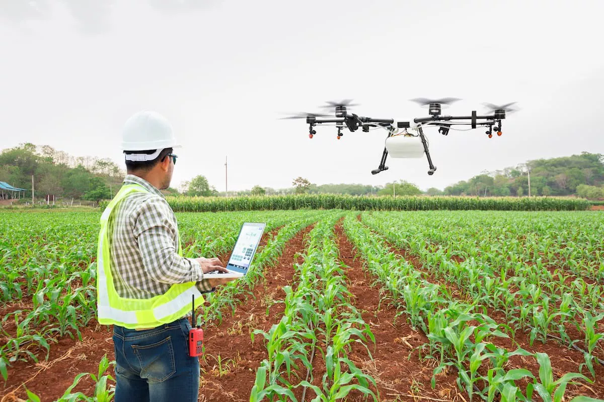
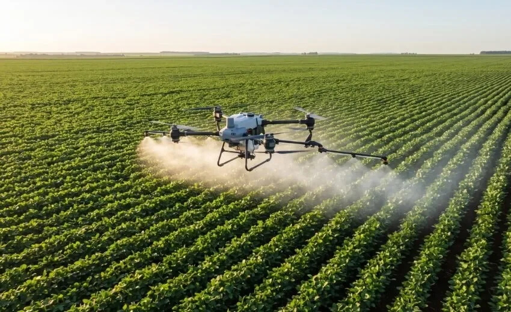
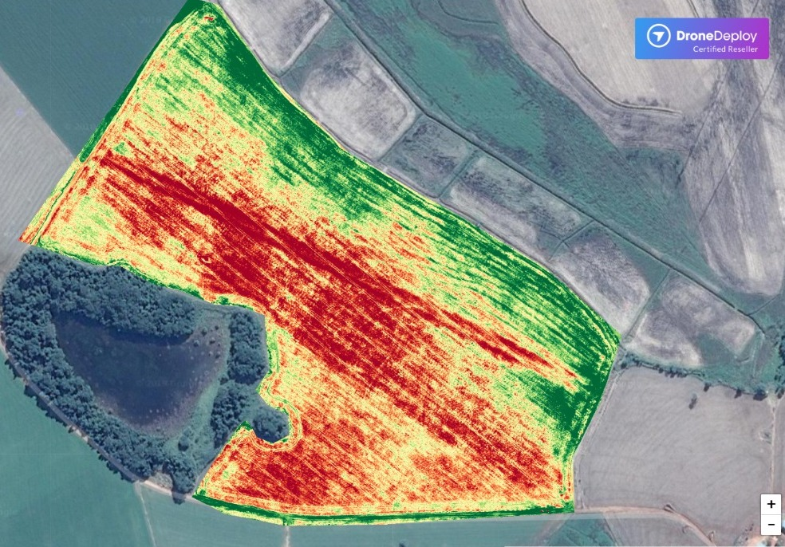
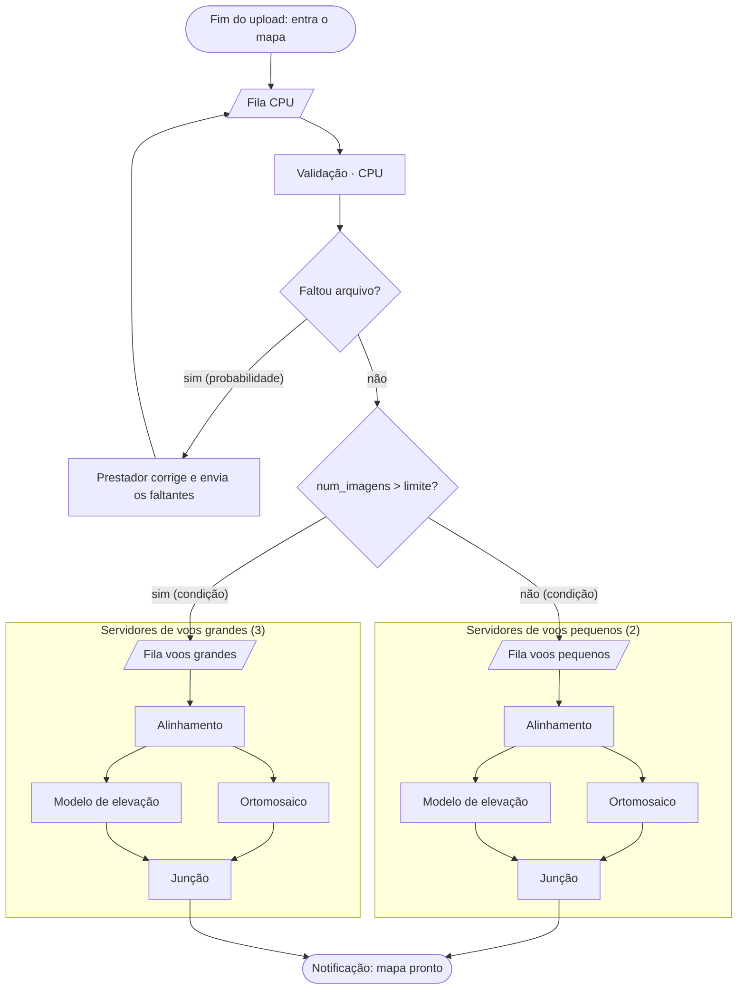
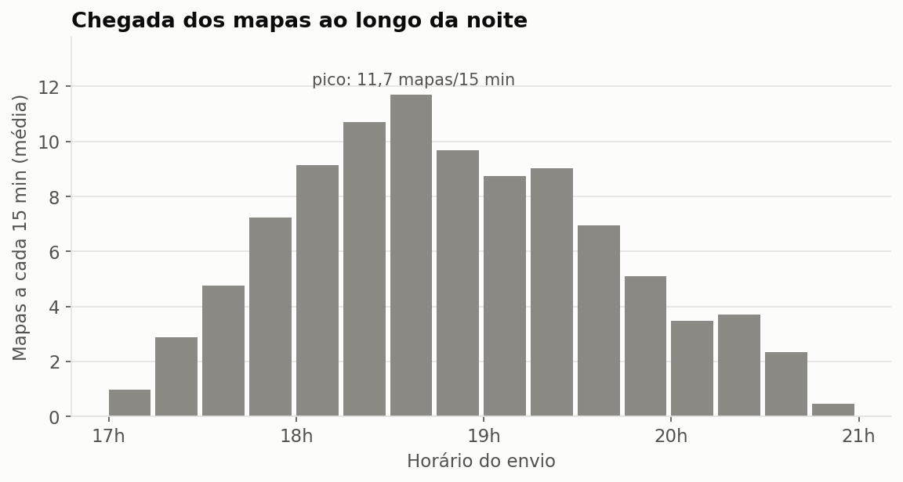
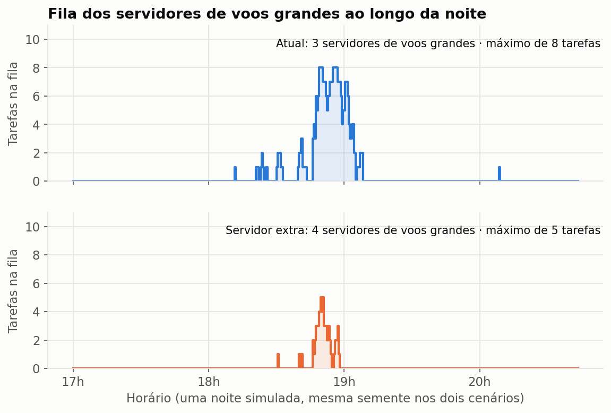
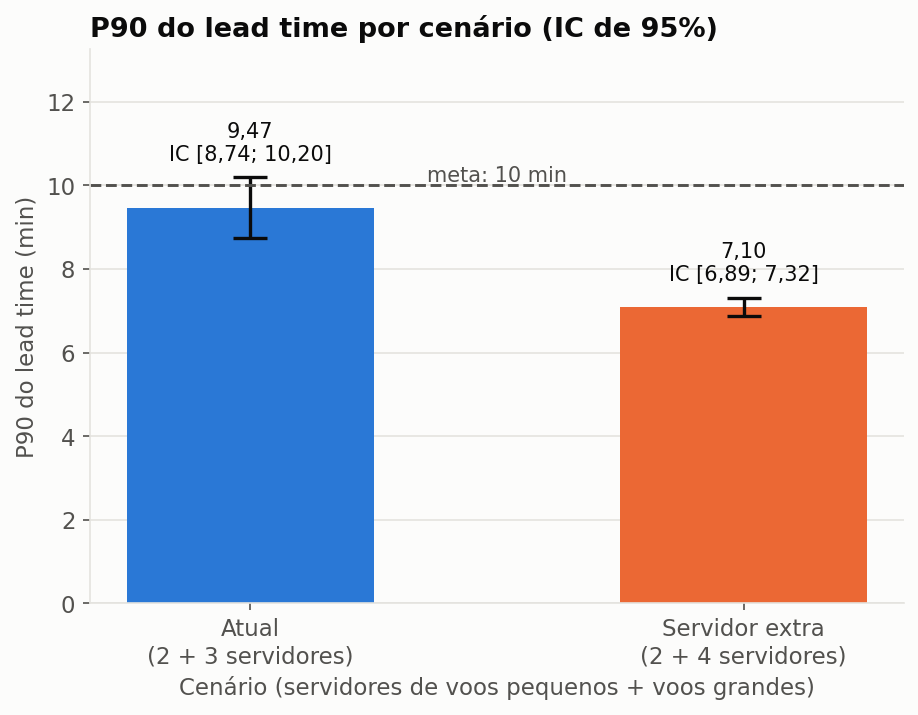
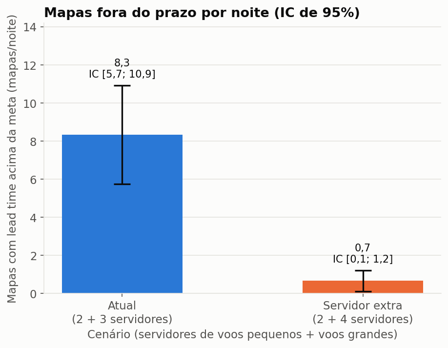
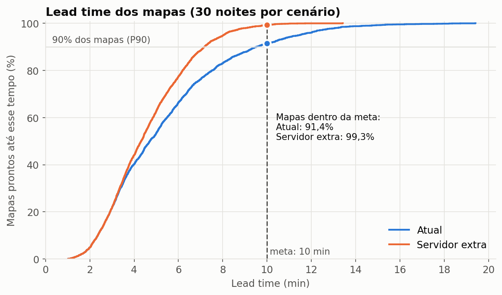
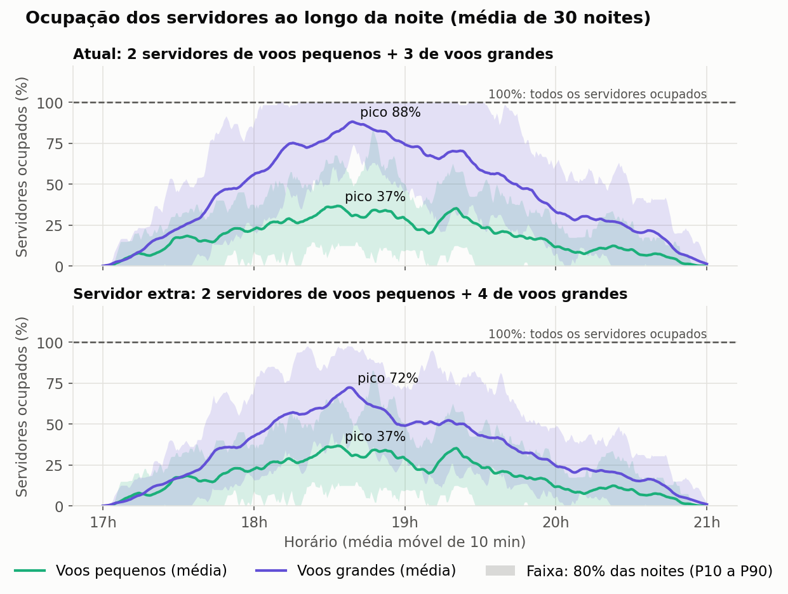

# Modelo conceitual: Processamento de Imagens de Drones

Documento-base do Trabalho do Grau B. Registra o sistema estudado, o modelo implementado pelo grupo, o motivo de cada decisão e os resultados da simulação. A ordem das seções acompanha a apresentação: primeiro o contexto, depois a plataforma, os detalhes do modelo, o experimento e os resultados.

**Situação:** o modelo está implementado em Python e SimPy na pasta [`../simulacao/`](../simulacao/), e os dois cenários já foram simulados (seção 5). Falta a animação em MP4 (ver [Pontos a verificar](#pontos-a-verificar)).

## 1. Introdução

### 1.1 Drones na agricultura

Os drones já fazem parte da rotina de muitas operações agrícolas. O Brasil tem cerca de **35 mil drones agrícolas**, e o número cresceu 12 vezes em cinco anos [[1]](#referências). Eles são usados de duas formas principais:

- **Geração de mapas:** o drone fotografa a lavoura, e as fotos viram mapas usados para planejar e acompanhar a produção.
- **Operações de campo:** a **pulverização de precisão**, por exemplo, aplica defensivos apenas onde é preciso. *Aparece aqui só como contexto e não é modelada.*

| Geração de mapas | Pulverização de precisão |
|---|---|
|  |  |

Este estudo trata da geração de mapas.

### 1.2 Exemplos de mapas

- **Mapa topográfico:** mostra o relevo do terreno, com a altura de cada ponto. Serve, por exemplo, para dimensionar um sistema de irrigação, já que o relevo determina o caminho da água e a pressão necessária nas tubulações. *Fonte a buscar.* É esse o tipo de mapa modelado no estudo, formado por ortomosaico e modelo de elevação (ver [2.2](#22-dentro-da-plataforma)).
- **Mapa NDVI:** um índice de vegetação calculado a partir de câmeras multiespectrais, que ajuda o produtor a estimar o vigor da plantação e a encontrar áreas com problema. *Fonte a buscar.*

*Mapa NDVI de um talhão: o vermelho indica vegetação de baixo vigor, e o verde, vegetação vigorosa.*

*Exemplo do tipo de plataforma estudada: um talhão de 0,48 ha mapeado com câmera multiespectral, exibido na camada NDVI. A tela também oferece RGB e outros índices (GNDVI, NDRE, LCI e OSAVI). A imagem é ilustrativa: mapas de índices como o NDVI ficam fora do escopo, e o estudo modela apenas ortomosaico e modelo de elevação.*

### 1.3 Como os mapas são gerados hoje

Pela manhã, a equipe de um **prestador de serviço** sai para atender uma fazenda. O cliente quer um mapa atualizado de um **talhão**, uma área delimitada da lavoura, para acompanhar o terreno e a plantação.

Em campo, o operador define a área do voo e o drone percorre o talhão em faixas paralelas. Ele fotografa o terreno em intervalos regulares, de modo que cada foto se sobreponha às vizinhas. É essa sobreposição que depois permite montar uma imagem única e reconstruir o relevo. Como referência, um mapeamento de **14 ha levou cerca de 23 minutos** de voo [[2]](#referências). Ao final, os arquivos ficam no cartão do drone, e a equipe segue para o próximo voo ou para outra fazenda.

No fim do dia, a equipe volta à empresa e sobe os arquivos de cada voo em uma **plataforma web**, que processa os dados e monta os mapas.

### 1.4 Objetivo do trabalho

Modelar e simular essa plataforma web, que recebe os arquivos dos voos e os transforma em mapas, para avaliar se ela entrega os mapas no prazo no período de maior demanda.

## 2. Plataforma de processamento de dados do drone

### 2.1 Visão do usuário

Para o prestador, o uso é simples: ele sobe os arquivos de cada voo e aguarda. Não precisa instalar software nem manter computadores potentes. Também não precisa acompanhar o processamento: fecha a plataforma e é notificado quando o mapa fica pronto.

Cada voo enviado dá origem a um **mapa**, que é o que a plataforma processa.

- **Quantidade de imagens por voo:** de 20 a 200, com valor mais comum de 80 (ver [4.2](#42-distribuições-de-entrada)).
- **Tamanho dos arquivos:** no mapeamento de 14 ha citado em 1.3, o drone gerou **87 fotos JPG de 11,7 MB cada**, cerca de **1 GB por voo** [[2]](#referências).

Às vezes falta algo, como fotos que ficaram para trás ao copiar o cartão. Nesse caso, a plataforma avisa o prestador, que envia o que faltou, e o mapa volta a ser conferido.

### 2.2 Dentro da plataforma

Quando recebe os arquivos, a plataforma começa o tratamento dos dados:

1. **Validação:** confere se o prestador enviou todos os arquivos necessários. Essa etapa roda em CPU, antes de ocupar um servidor de processamento.
2. **Alinhamento:** identifica pontos em comum entre as fotos sobrepostas e calcula a posição de cada uma. O resultado serve de base para os dois produtos seguintes.
3. **Geração dos produtos,** feita em paralelo a partir do alinhamento:
   - **Ortomosaico:** as fotos costuradas e corrigidas, formando uma imagem única e sem distorção.
   - **Modelo de elevação:** a altura de cada ponto do terreno, que dá o caráter topográfico ao mapa.
4. **Entrega:** quando os dois produtos terminam, o mapa fica pronto e o prestador é notificado.

O alinhamento e os produtos rodam em **servidores de processamento**, máquinas com GPU dedicadas à fotogrametria. Os servidores são divididos em dois grupos, um para voos pequenos e outro para voos grandes, para que os mapas grandes não bloqueiem os pequenos.

Como referência, o SmartFarm Web processou o ortomosaico e o modelo digital de superfície de um mapa de **12 ha em cerca de 5 minutos** [[3]](#referências). Esse tempo não inclui o upload das imagens, que também fica fora do modelo.

O fluxograma abaixo mostra esse caminho como ele é representado no modelo:

*Legenda:* o mapa entra quando termina o primeiro upload e passa pela validação em CPU. Se faltar arquivo, volta à fila da CPU após a correção pelo prestador. Se estiver completo, segue a rota definida pelo número de imagens e usa somente os servidores desse grupo até o fim. Cada grupo tem uma única fila, usada por todas as etapas: depois do alinhamento, ortomosaico e modelo de elevação voltam a essa fila e disputam os servidores com os mapas que ainda vão alinhar. A junção espera os dois produtos, e o mapa segue para a notificação.

### 2.3 O problema de gestão

Como as equipes voltam do campo em horários parecidos, os envios se concentram no fim do dia e disputam os mesmos servidores. Formam-se filas justamente no período de maior demanda, e o prestador tem um prazo a cumprir com o cliente.

A plataforma promete o mapa em até **10 minutos**. A gestão precisa saber se a capacidade atual cumpre essa meta no pico ou se vale a pena colocar **mais um servidor em paralelo**.

## 3. Detalhes da modelagem

### 3.1 Entidades e atributos

**Entidade:** mapa, que representa o processamento de um voo, do fim do primeiro upload até a notificação.

| Atributo | Significado | Uso no modelo |
|---|---|---|
| `num_imagens` | Quantidade de imagens do voo | Define a rota e os tempos de processamento |
| `rota` | Voo pequeno ou voo grande | Define o grupo de servidores |
| `tentativas` | Número de passagens pela validação | Identifica mapas que precisaram de correção |
| `instante_entrada` | Fim do primeiro upload | Início do lead time; não muda em caso de reenvio |
| `instante_saida` | Notificação de mapa pronto | Fim do lead time |

### 3.2 Recursos

| Recurso | Capacidade (cenário atual) | Etapas |
|---|---|---|
| `CPU` | 1 | Validação |
| `Servidores de voos pequenos` | 2 | Alinhamento e produtos dos mapas até o limite de imagens |
| `Servidores de voos grandes` | 3 | Alinhamento e produtos dos mapas acima do limite |

Cada servidor é uma máquina com GPU, e todos têm a mesma velocidade. Cada etapa ocupa um servidor e o libera ao terminar. Os dois produtos disputam os servidores de forma independente, então só rodam ao mesmo tempo se houver dois livres.

O prestador não é um recurso: a correção é um atraso sem fila, porque cada um corrige o próprio envio.

### 3.3 Filas

`Fila CPU`, `Fila voos pequenos` e `Fila voos grandes`, todas FIFO e sem limite de buffer. Nenhum mapa é descartado ou desiste.

Cada grupo de servidores tem uma única fila, compartilhada por alinhamento, ortomosaico e modelo de elevação. Um mapa entra nela três vezes, uma por tarefa, e o servidor que fica livre pega a tarefa mais antiga, sem distinguir o tipo.

### 3.4 Regras de fluxo

- **Decisão por probabilidade:** na validação, cada tentativa tem a mesma chance de detectar arquivos faltando. O mapa repete a validação até passar.
- **Reenvio:** o prestador envia só os arquivos faltantes, o que não altera `num_imagens`. O relógio do lead time continua correndo.
- **Decisão por condição:** mapas com `num_imagens` acima do limite vão para os servidores de voos grandes; os demais, para os de voos pequenos.
- **Fluxo paralelo:** após o alinhamento, o mapa se duplica em ortomosaico e modelo de elevação. A junção espera os dois, e o mapa sai quando o último termina.

### 3.5 Indicadores

1. **P90 do lead time (indicador principal),** em minutos, medido do fim do primeiro upload até a notificação de mapa pronto, incluída a correção pelo prestador, com meta de até 10 min. É calculado por noite simulada, e o IC de 95% é obtido entre as replicações.
2. **Mapas fora do prazo,** em mapas por noite, medidos do fim do primeiro upload até a notificação de mapa pronto, contando aqueles com lead time acima de 10 min, com meta de até 10% dos mapas da noite. *O percentual é uma proposta a confirmar.*

**Complementares:** lead time médio (min), vazão (mapas/h) e utilização de cada grupo de servidores (%).

### 3.6 Implementação

O modelo está em [`../simulacao/`](../simulacao/), em scripts Python que rodam localmente. Os parâmetros ficam como constantes no topo de `modelo.py`, com os mesmos valores da seção 4.2.

| Elemento do modelo | Onde está no código (`modelo.py`) |
|---|---|
| Entidade mapa e seus atributos | classe `Mapa` (`num_imagens`, `rota`, `tentativas`, `instante_entrada`, `instante_saida`) |
| Chegadas da noite | `gerar_mapas` sorteia a quantidade (Poisson), os horários (Triangular) e `num_imagens`; `chegadas` libera cada mapa no seu horário |
| Validação e reenvio | laço em `processar_mapa`: CPU (`simpy.Resource`), sorteio da falta de arquivos e atraso da correção |
| Rota por `num_imagens` | definida em `gerar_mapas` (`num_imagens > LIMITE_ROTA`) |
| Servidores e filas | um `simpy.Resource` por grupo, com fila FIFO única para as três etapas |
| Alinhamento, produtos em paralelo e junção | `tarefa_servidor`; os dois produtos são processos SimPy separados, e a junção é `ortomosaico & elevacao` |
| Monitor para gráficos e animação | `monitor` amostra filas, servidores ocupados e mapas concluídos a cada 0,5 min |
| Indicadores | `calcular_metricas` |

Os outros scripts usam esse módulo: `executar_cenarios.py` roda as 30 replicações por cenário e calcula os IC; `graficos.py` gera os gráficos da seção 5.3. Para rodar, a partir de `grau-b/simulacao/`: `../../.venv/bin/python executar_cenarios.py` e `../../.venv/bin/python graficos.py`.

Cada mapa tem um gerador aleatório próprio, derivado da semente da replicação e do seu número. Assim, a replicação *i* tem os mesmos mapas e os mesmos tempos nos dois cenários (números aleatórios comuns), e a diferença entre eles vem só da capacidade.

## 4. Experimento e premissas

### 4.1 Chegadas e horizonte

Os envios se concentram no fim do dia, com pico entre 17h e 21h. Cada replicação simula uma noite de pico, com relógio em minutos, e termina quando o último mapa fica pronto. Por isso, é uma simulação terminante.

### 4.2 Distribuições de entrada

Os tempos de processamento vêm de um benchmark publicado [[4]](#referências). Validação, falta de arquivos e correção ainda não têm fonte.

| Grandeza | Distribuição | Parâmetros | Unidade | Justificativa |
|---|---|---|---|---|
| Mapas por noite | Poisson | média 100 | mapas/noite | Dimensionada para que os servidores de voos grandes fiquem perto de 90% de ocupação no pico do cenário atual |
| Horário de envio | Triangular | mín 17h, moda 18h30, máx 21h | hora | Retorno concentrado das equipes no fim do dia, com pico às 18h30 |
| `num_imagens` | Triangular | mín 20, moda 80, máx 200 | imagens | Exemplo real: 14 ha geraram 87 imagens [[2]](#referências), perto da moda |
| Limite da rota | Constante | 80 | imagens | Igual à moda: cerca de 1/3 dos mapas vai para os servidores de voos pequenos |
| Tempo de validação | Uniform | mín 5, máx 15 | s | A preencher |
| Falta de arquivos | Bernoulli | 5% por tentativa | probabilidade | A preencher |
| Tempo de correção | Uniform | mín 1, máx 3 | min | A preencher |
| Alinhamento | Uniform | mín 0,69, máx 1,03 | s/imagem | Etapa *calibration* do PIX4Dmatic: 86 s para 100 imagens, ou 0,86 s/imagem [[4]](#referências); variação de ±20% assumida |
| Modelo de elevação | Uniform | mín 1,22, máx 1,84 | s/imagem | Etapas *dense point cloud* e *DSM*: 115 s + 38 s para 100 imagens, ou 1,53 s/imagem [[4]](#referências); variação de ±20% assumida |
| Ortomosaico | Uniform | mín 0,15, máx 0,23 | s/imagem | Etapa *orthomosaic*: 19 s para 100 imagens, ou 0,19 s/imagem [[4]](#referências); variação de ±20% assumida |

Em cada etapa de processamento, o tempo é `num_imagens` × tempo por imagem sorteado. Os dois grupos de servidores têm a mesma velocidade.

**Conferência com a plataforma real:** com esses tempos, um mapa de 12 ha (cerca de 75 imagens, a 6 imagens/ha [[2]](#referências)) leva cerca de 3 min sem fila: 64 s de alinhamento e 115 s de modelo de elevação. O SmartFarm Web levou cerca de 5 min para o mesmo tamanho [[3]](#referências). A ordem de grandeza bate, e a diferença cabe no overhead da nuvem.

### 4.3 Cenários

| Cenário | Servidores de voos pequenos | Servidores de voos grandes | Demanda | Replicações |
|---|---|---|---|---|
| Atual | 2 | 3 | Pico | ≥ 30 |
| Servidor extra | 2 | 4 | Pico | ≥ 30 |

O servidor extra vai para o grupo de voos grandes, que é o gargalo. Pela conta manual no instante de maior demanda (cerca de 50 mapas/h), esse grupo fica perto de 96% de ocupação no cenário atual e de 72% com o servidor extra. O grupo de voos pequenos fica perto de 36%.

A comparação usa o IC de 95% do P90 do lead time. Intervalos que não se sobrepõem indicam diferença conclusiva; intervalos sobrepostos não permitem concluir pela diferença.

### 4.4 Questões do estudo

1. Na situação atual, o P90 do lead time atende à meta de 10 min no pico?
2. Um servidor a mais em paralelo reduz o P90 do lead time com IC sem sobreposição? Em quantos minutos?
3. Quantos mapas por noite deixam de ficar fora do prazo com o servidor extra?

### 4.5 Classificação do sistema

- **Dinâmico:** o estado muda ao longo da noite, com filas que crescem no pico e depois se esvaziam.
- **Estocástico:** chegadas, quantidades de imagens por mapa, tempos de serviço e falta de arquivos são aleatórios.
- **Discreto:** o estado muda em instantes definidos, como chegadas e conclusões de etapas.

### 4.6 Hipóteses e simplificações

- **Voos de até 200 imagens:** com cerca de 2,4 s por imagem entre alinhamento e modelo de elevação [[4]](#referências), um mapa de 200 imagens leva cerca de 8 min sem fila, dentro da meta de 10 min. Voos maiores ficam fora do escopo.
- **Tempos proporcionais:** os tempos de processamento crescem na proporção do número de imagens.
- **Servidores iguais:** todos têm a mesma velocidade, porque a GPU muda pouco o tempo total [[4]](#referências) [[5]](#referências).
- **Ortomosaico em paralelo:** no PIX4Dmatic, o ortomosaico é gerado depois do modelo de superfície [[4]](#referências). O modelo trata os dois em paralelo. Como o ortomosaico é curto (0,19 s/imagem), o efeito no lead time é pequeno.
- **Upload fora do modelo:** o relógio começa no fim do primeiro upload. O envio dos faltantes faz parte do tempo de correção.
- **Prestador sempre corrige:** não há desistência, e a correção não depende de quantos arquivos faltaram.
- **Sem falhas técnicas:** os servidores não param, e o alinhamento e a geração dos produtos sempre dão certo.
- **Mapas de índices fora do escopo:** a plataforma do exemplo também exibe índices como o NDVI, mas o estudo modela apenas ortomosaico e modelo de elevação.
- **Apenas a noite de pico:** os resultados não se aplicam a períodos de demanda normal.

## 5. Resultados da simulação

Os resultados foram gerados pelo programa em `../simulacao/`, com 30 replicações por cenário. Os dois cenários usam números aleatórios comuns: a replicação *i* tem os mesmos mapas e os mesmos tempos sorteados nos dois cenários, e só muda o número de servidores.

### 5.1 Indicadores por cenário

Média das 30 noites, com IC de 95% (t de Student).

| Indicador | Atual (2 + 3 servidores) | Servidor extra (2 + 4 servidores) | Meta |
|---|---|---|---|
| **P90 do lead time** | **9,47 min**, IC [8,74; 10,20] | **7,10 min**, IC [6,89; 7,32] | até 10 min |
| **Mapas fora do prazo** | **8,3 mapas/noite**, IC [5,7; 10,9] | **0,7 mapas/noite**, IC [0,1; 1,2] | — |
| Mapas fora do prazo (%) | 8,5%, IC [5,9; 11,0] | 0,7%, IC [0,1; 1,2] | até 10% |
| Lead time médio | 5,37 min, IC [5,12; 5,61] | 4,57 min, IC [4,46; 4,68] | — |
| Vazão | 25,5 mapas/h | 25,5 mapas/h | — |
| Utilização, voos grandes (noite inteira) | 47,5% | 35,6% | — |
| Utilização, voos pequenos (noite inteira) | 19,5% | 19,5% | — |

*"2 + 3 servidores" significa 2 servidores de voos pequenos e 3 de voos grandes.* A vazão é igual nos dois cenários porque todos os mapas terminam e a noite acaba quase na mesma hora; por isso ela não serve para comparar os cenários.

### 5.2 Respostas às questões do estudo

1. **O cenário atual atende à meta de 10 min no pico?** Não é possível afirmar. O P90 médio é de 9,47 min, mas o IC [8,74; 10,20] contém a meta. Na prática, o cenário atual opera no limite.
2. **Um servidor a mais reduz o P90 com IC sem sobreposição?** Sim. O P90 cai 2,37 min, de 9,47 para 7,10 min, e os intervalos não se sobrepõem: a diferença é conclusiva. Com o servidor extra, o IC inteiro fica abaixo da meta.
3. **Quantos mapas deixam de ficar fora do prazo?** Cerca de 7,7 mapas por noite, de 8,3 para 0,7. Dentro da meta, a proporção de mapas sobe de 91,4% para 99,3%.

### 5.3 Gráficos

**Chegada dos mapas.** Os envios crescem a partir das 17h, chegam ao pico entre 18h30 e 18h45 (cerca de 12 mapas a cada 15 min) e caem até as 21h. Esse pico é o que forma a fila.

**Fila dos servidores de voos grandes, em degraus.** Uma noite simulada, com os mesmos mapas nos dois cenários. A fila conta tarefas, e cada mapa entra nela três vezes (alinhamento, ortomosaico e elevação). No cenário atual, a fila chega a 8 tarefas entre 18h45 e 19h05; com o servidor extra, a mesma onda chega a 5 e esvazia mais rápido. No resto da noite, a fila fica praticamente vazia nos dois cenários.

**P90 do lead time por cenário, com IC em barras de erro.** É o gráfico de comparação do indicador principal.

**Mapas fora do prazo por noite, com IC.** O IC do cenário atual é largo porque algumas noites têm um pico mais forte que outras.

**Distribuição do lead time.** Proporção de mapas prontos até cada tempo, juntando as 30 noites. Até cerca de 3,5 min as curvas coincidem: esses mapas são processados sem fila. Depois, o cenário atual tem uma cauda longa, com mapas de até cerca de 19 min; com o servidor extra, todos terminam em menos de 14 min. O servidor extra quase não muda o mapa típico, mas corta a cauda do pico, que é o que o P90 mede.

**Ocupação dos servidores ao longo da noite.** A linha é a média das 30 noites, e a faixa sombreada cobre 80% das noites (do percentil 10 ao 90). No cenário atual, os servidores de voos grandes chegam a 88% de ocupação média por volta das 18h40, e a borda de cima da faixa encosta em 100% entre cerca de 18h e 19h40. Às 18h40, 27 das 30 noites estavam com os 3 servidores ocupados. A média fica abaixo de 100% porque o pico não acontece na mesma hora em todas as noites (de 17h59 a 19h19) e porque a curva é suavizada. Com o servidor extra, o pico médio cai para 72%, e a faixa raramente chega a 100%. Os servidores de voos pequenos não passam de 37% em média nos dois cenários.

### 5.4 Conclusões e recomendações

- **O gargalo está nos servidores de voos grandes,** como previa a conta manual: 88% de ocupação média no pico, contra 37% nos de voos pequenos.
- **O cenário atual opera no limite da meta:** P90 de 9,47 min, com IC que contém os 10 min, e cerca de 8,3 mapas por noite fora do prazo.
- **Recomendação: acrescentar um servidor de voos grandes.** O P90 cai 2,37 min, para 7,10 min, com IC inteiro abaixo da meta, e os mapas fora do prazo caem de 8,3 para 0,7 por noite.
- **O ganho se concentra no pico.** Antes das 17h45 e depois das 20h, os dois grupos ficam abaixo de 50% de ocupação média. Se a plataforma roda na nuvem, um servidor a mais só no horário de pico pode dar ganho parecido com custo menor. *O modelo atual não testa essa alternativa.*

## 6. Controle do trabalho

### Atendimento aos requisitos do enunciado (seção 3)

| Item | Requisito | Solução no modelo |
|---|---|---|
| a | Base do estudo | Este documento; justificativas das distribuições parcialmente pendentes |
| b | Decisões | Probabilidade: falta de arquivos. Condição: rota por `num_imagens` |
| c | Indicadores | Mapas fora do prazo (contagem) e P90 do lead time |
| d | Atributo com significado | `num_imagens`, usado na rota e nos tempos |
| e | Lotes ou duplicações | Ortomosaico e modelo de elevação em paralelo, com junção |
| f | Demonstração visual | Monitor implementado (amostras a cada 0,5 min). **Falta** a animação em MP4, com título do cenário, relógio, ao menos três indicadores com unidade e um gráfico com eixos rotulados |
| g | Gráficos de resultados | Gerados (seção 5.3): fila de voos grandes em degraus; P90 do lead time por cenário, com IC em barras de erro |
| h | Experimentação | Feito: dois cenários, 30 replicações cada e IC de 95% do P90 (seção 5.1) |
| i | Análise | Feito: conclusões e recomendações com número, unidade e comparação (seção 5.4) |

### Registro de decisões

| Decisão | Por quê | Alternativas descartadas |
|---|---|---|
| Python + SimPy | Ferramenta aceita pela disciplina e já usada no Grau A | JaamSim, Arena |
| Scripts Python locais em vez de caderno | Mais fácil de rodar, versionar e dividir entre os integrantes | Caderno Jupyter (pode ser gerado no fim, se o enunciado exigir) |
| Números aleatórios comuns entre os cenários | A replicação *i* simula a mesma noite nos dois cenários, o que reduz a variância da comparação | Sementes independentes por cenário |
| Usuário: prestador de serviço | Envia vários voos e tem prazos a cumprir com clientes, o que dá sentido à meta | Produtor rural; os dois perfis |
| Upload ao fim do voo, chegando à plataforma no fim do dia | A equipe termina o campo, volta à empresa e sobe os arquivos, o que concentra a demanda | Envio imagem a imagem; upload no campo com falhas |
| Prestador sai e é notificado | Corresponde ao uso esperado e mantém o lead time como foco | Cancelar na fila; reenviar por demora |
| Falha na validação, por falta de arquivos | É um erro do prestador, detectado antes de ocupar um servidor | Falha no alinhamento; falha maior em mapas grandes; limite de reenvios |
| Reenvio só dos faltantes, repetindo até dar certo | Todo mapa termina, e o lead time fica definido para todos | Reenviar o voo inteiro |
| Lead time desde o primeiro envio | Mostra a espera real e segue a definição do enunciado | Contar cada envio separadamente |
| Rota por `num_imagens` | É uma decisão condicional natural, dá uso direto ao atributo e impede que mapas grandes bloqueiem os pequenos | Rejeição por qualidade; prioridade por prazo |
| Ortomosaico + modelo de elevação em paralelo | Tarefas paralelas a partir do alinhamento, sem exigir câmera multiespectral. Na prática o ortomosaico depende da superfície, mas é curto | Mapa de índices; blocos de imagens; voos em lote |
| Servidores de processamento, todos com a mesma velocidade | Benchmark mostra 5% a 9% de diferença entre GPUs [[4]](#referências); a GPU acelera só o alinhamento [[5]](#referências) | Velocidades diferentes por grupo de servidores |
| Tempos por imagem do benchmark da Puget Systems | É a fonte mais recente encontrada com tempo por etapa, em 100 imagens, perto da nossa moda | OpenDroneMap, cerca de 10 vezes mais lento [[6]](#referências); comparações entre softwares com resultados contraditórios |
| Fila única FIFO por grupo de servidores | É a regra mais simples de implementar e explicar. Em troca, mapas já alinhados podem esperar atrás de novos mapas | Prioridade para os produtos; servidores separados por etapa |
| Comparar atual e um servidor extra no pico | Responde à decisão de investimento: mais capacidade em paralelo no grupo que é o gargalo | Atual, +1 e +2 servidores; dobrar os servidores |
| Meta de 10 min | Com os tempos do benchmark, um mapa de 200 imagens leva cerca de 8 min sem fila; com 5 min, o P90 nunca atingiria a meta | 5 min (inviável com os tempos reais); 5 min com voos de até 120 imagens |
| Demanda de 100 mapas por noite | Deixa o cenário atual perto de 90% de ocupação no pico com poucos servidores, o que mantém a animação legível | 250 mapas por noite, com cerca de 9 servidores |
| Chegadas Triangular(17h, 18h30, 21h) | Representam o retorno concentrado das equipes e fazem a fila crescer | Poisson em janela fixa; pulsos por empresa |
| Contagem: mapas fora do prazo | Reage ao servidor extra e ajuda a comparar os cenários | Mapas reenviados; mapas concluídos |
| Ordem do documento segue a apresentação | Contexto agrícola, plataforma e só então o modelo, o que facilita a leitura por quem não acompanhou as decisões | Ordem "sistema → modelo" |

### Pontos a verificar

- [ ] **Valores sem fonte:** validação, falta de arquivos e correção.
- [ ] **Variação dos tempos:** o benchmark dá um valor por etapa; a variação de ±20% é uma suposição do grupo.
- [ ] **Meta de mapas fora do prazo:** confirmar o limite de 10% e definir o valor absoluto.
- [x] **Gargalo:** confirmado nos servidores de voos grandes, com 88% de ocupação média no pico, contra 37% nos de voos pequenos (seção 5.3).
- [x] **Sensibilidade da comparação:** confirmada. O cenário atual fica no limite da meta (P90 de 9,47 min), e a diferença entre os cenários é conclusiva (seção 5.1).
- [x] **Peso dos reenvios:** confirmado que não determinam o P90. Sem os mapas com reenvio (5,2% dos mapas), o P90 do cenário atual cai só de 9,47 para 9,33 min.
- [ ] **Formato do entregável:** o enunciado pede o modelo em caderno. Confirmar com o professor se os scripts são aceitos ou gerar um `.ipynb` que chame os scripts.
- [ ] **Fontes da introdução:** buscar referências para o uso de mapas topográficos no dimensionamento de irrigação e para o NDVI.

### Próximos passos

**Feito:** modelo em SimPy, 30 replicações por cenário com IC, gráficos de resultados, conclusões e recomendações (seções 3.6 e 5).

**A fazer:**

1. Gerar a animação em MP4 com `FuncAnimation`, a partir das amostras do monitor (requisito f).
2. Buscar fontes para os tempos de validação, a falta de arquivos e o tempo de correção.
3. Confirmar o formato do entregável do modelo (scripts ou caderno).
4. Obter no Moodle o template do relatório e confirmar a data de entrega.
5. Escrever o relatório, com a declaração de uso de IA, e preparar os slides com o vídeo.

## Referências

1. VALOR ECONÔMICO. Número de drones cresceu 12 vezes em cinco anos. *Valor Econômico*, especial Agronegócio, 27 abr. 2026. Disponível em: <https://valor.globo.com/publicacoes/especiais/agronegocio/noticia/2026/04/27/numero-de-drones-cresceu-12-vezes-em-cinco-anos.ghtml>. Usada para: cerca de 35 mil drones agrícolas no Brasil (seção 1.1).
2. WDDRONES. Tutorial completo DJI SmartFarm Web (2025). YouTube, 2025. Disponível em: <https://www.youtube.com/watch?v=7vQuAK239-k&t=32s>. Usada para: mapeamento de 14 ha em cerca de 23 minutos de voo (seção 1.3), com 87 fotos JPG de 11,7 MB cada (seções 2.1 e 4.2).
3. AMERICA AGRICOLA. Como gerar ortomosaico e modelo digital de superfície no SmartFarm Web | DJI | Victor Agostinho. YouTube. Disponível em: <https://www.youtube.com/watch?v=44Iz9D4oGvk&t=612s>. Usada para: processamento de 12 ha em cerca de 5 minutos, aos 10:12 do vídeo (seções 2.2 e 4.2).
4. LAGERGREN, Evan. Exploring PIX4Dmatic hardware performance. *Puget Systems*, 26 nov. 2025. Disponível em: <https://www.pugetsystems.com/labs/articles/exploring-pix4dmatic-hardware-performance/>. Usada para: tempos por etapa com 100 imagens na RTX 5080 (calibration 86 s, dense point cloud 115 s, DSM 38 s, orthomosaic 19 s) e diferença de 5% a 9% entre GPUs (seções 2.3, 4.2 e 4.6).
5. PIX4D. Hardware and computer setup. *Pix4D Support*. Disponível em: <https://support.pix4d.com/hc/en-us/articles/115003928846>. Usada para: a CPU pesa mais que a GPU no tempo total, e a GPU reduz só o alinhamento, em 10% a 20% (seções 2.3 e 4.6).
6. FERREIRA, Carlos Y. M. et al. Edge computing in photogrammetry: performance and trade-offs of OpenDroneMap on NVIDIA Jetson Nano. In: ESCOLA REGIONAL DE ALTO DESEMPENHO DA REGIÃO NORDESTE (ERAD-NE), 7., 2026, Recife. *Anais* [...]. Porto Alegre: SBC, 2026. p. 29-32. DOI: 10.5753/erad-ne.2026.26672. Usada para: no OpenDroneMap, 46 imagens levaram 19 min 50 s em desktop, cerca de 26 s/imagem, com a GPU abaixo de 2% de uso (registro de decisões).
